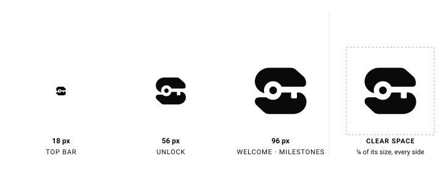
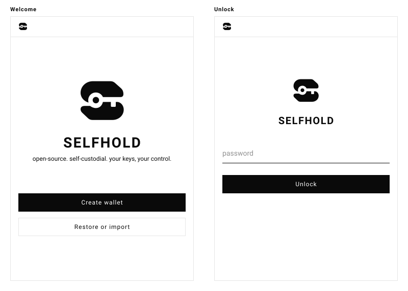
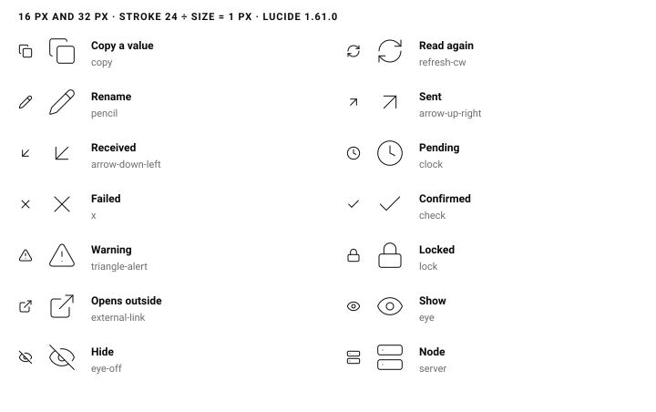
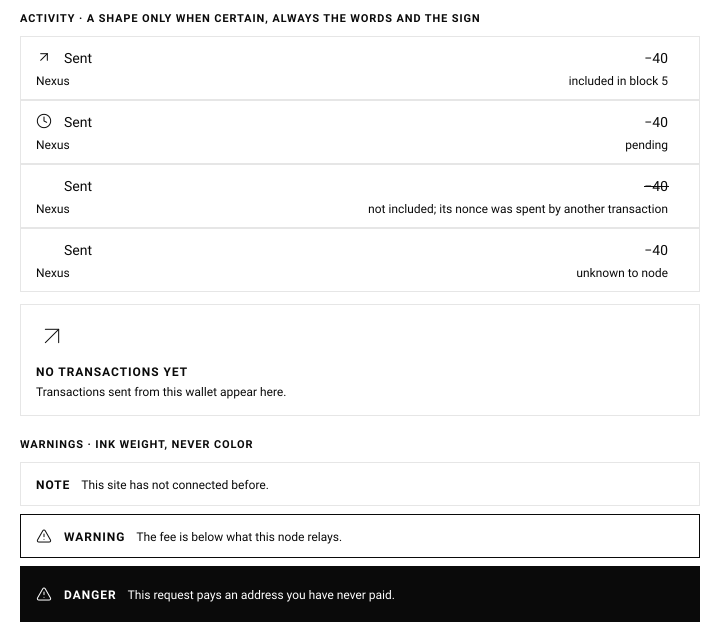

# Selfhold brand and graphics guidebook

How Selfhold looks, and why. The rule under every rule: **Selfhold is minimal and
monochrome, and its one signature is its own mark.** Everything here either
shows that mark, says something the person needs, or is left out.

The research behind these rules, with sources, is summarized at the end. The
specimens below are generated by `npm run specimens`
(`scripts/render-brand-specimens.mjs`) from the master mark and the icon
geometry. Never edit them by hand.

## 1. Principles

1. **One signature: the mark.** The S with the key cut into it is the only
   brand graphic. It appears at a few fixed moments and is never decoration.
2. **Monochrome.** Ink on paper, in light and dark. There is no accent color,
   no gradient and no tint. State is shown by shape, words and ink weight.
3. **Inversion is spent, not sprinkled.** A filled black (in dark mode, white)
   area means one of three things: the step that moves a screen forward, a
   danger, or a state that needs action. Nothing else is filled.
4. **Words first.** Every icon sits beside a word, except the three familiar
   actions in §5. An icon never replaces a label it can't fully stand in for.
5. **Selfhold is not Lattice.** Lattice's devices stay out of Selfhold: the
   dot grid and dot matrix (`.lattice-bg`, "the dot-lattice"), and the
   Lattice wordmark. Selfhold runs on Lattice; it doesn't wear its logo.

## 2. The mark

The master is `public/assets/selfhold-mark.svg`: two paths and a circle on a
320-unit square. It is filled, with no strokes, fonts or effects.

| Size | Where | Notes |
|---|---|---|
| 18 px | Top bar of every screen, onboarding included; the approval window | With no wordmark beside it, it carries `role="img"` and `aria-label="Selfhold"`. |
| 56 px | Unlock | Above the wordmark. |
| 96 px | Welcome; the two milestones (wallet created, backup confirmed) | Above the wordmark. |

These are the only sizes. A new place for the mark needs one of them and a
reason as strong as the ones above.

- **Clear space:** a quarter of the mark's size on every side. Nothing else
  enters it: no text, rule or button.
- **Color:** in the interface the mark takes the text color (`fill:
  currentColor`, which is `--ink`), so it follows light and dark mode and
  Windows high contrast by itself. It is the only filled graphic in the
  interface, which keeps it distinct from the stroked icons.
- **Small sizes:** the toolbar icons at 16 and 32 px open the key shaft and
  enlarge the bow optically (`npm run icons`). The 18 px interface mark is
  the master, unchanged.
- **Never:** outline it, stroke it, rotate it, crop it, recolor it, shadow it,
  put it in a shape (except the toolbar tile, §9), animate it outside the two
  milestones, render it as dots or pixels, or set it in a sentence as a letter
  S.
- **Not in empty states.** The mark marks thresholds: arriving, unlocking, a
  milestone. On every empty list it would turn into wallpaper.

## 3. Wordmark and lockups

- The wordmark is **SELFHOLD** in the interface typeface: uppercase, weight
  600, tracking 0.08em. It is the word, never a drawn logotype.
- **Stacked lockup:** the mark centered above the wordmark, which sits
  outside the mark's clear space. Used on Welcome (mark 96, wordmark 28) and
  Unlock (mark 56, wordmark 20).
- The name is always **Selfhold**: one word, capital S in running text, all
  caps only as the wordmark or a label. Never "Lattice Wallet" (its old name),
  "SelfHold" or "Self Hold".
- **Descriptor:** "Open-source, self-custodial wallet for Lattice."
  **Tagline:** "Your keys. Your control." The welcome screen's tagline is
  the short form: "open-source. self-custodial. your keys, your control."

## 4. Color, type and space

The tokens in `public/assets/tokens.css` are the source. This section says
how to use them.

| Token | Light | Dark | Use |
|---|---|---|---|
| `--paper` | `#ffffff` | `#0a0a0a` | Background |
| `--ink` | `#0a0a0a` | `#ededed` | Text, rules that matter, the mark, icons, filled areas |
| `--line` | `#e6e6e6` | `#1c1c1c` | Hairline rules and outlines |

Ink on paper is about 19.8:1. The only lighter tone allowed is placeholder
text in fields; never set body text in grey.

**Typeface: the system sans.** San Francisco on macOS, Segoe UI on Windows,
Roboto or Cantarell elsewhere, with nothing shipped or fetched. This is what
people have always seen in Selfhold: Chrome injects `body { font-family:
system-ui, sans-serif; font-size: 75% }` into extension pages, and that
overrides any font set on `html`. So `tokens.css` sets the family and size
on `body` itself, and nothing injected decides. Raw data (a transaction's
JSON) is the one place for monospace, `--mono`.

- Amounts, nonces and counts use tabular numerals
  (`font-variant-numeric: tabular-nums`).
- Labels, headings and buttons: uppercase, weight 600 for headings and
  labels, tracking 0.08em. Running text: sentence case, regular weight.
- Sizes: the token scale only (12, 14, 16, 20, 28, 44 px).

**Space:** the 8 px unit and its token steps (4, 8, 16, 24, 40, 64, 96).
**Corners:** radius 0. **Rules:** 1 px, real `border` or `outline` (never
`box-shadow`, which high contrast mode removes). Draw a rule only where it
separates two things a person must tell apart; separators added "just
because" are the first noise to cut.

## 5. Icons

**Source:** Lucide only (ISC), at the geometry in
`scripts/render-brand-specimens.mjs`. Don't mix in other sets. If a needed
glyph doesn't exist, draw one to Lucide's rules (24 grid, 1 px padding, one
centered stroke, integer coordinates, at least 2 units between elements).

**Weight:** always exactly 1 px. On the 24-unit grid that is
`stroke-width = 24 ÷ size`: 1.5 at 16 px, 1.2 at 20, 0.75 at 32. Keep
Lucide's round caps, joins and small corner radii as drawn; at these sizes
they read as square next to the radius-0 interface, and forcing square caps
would leave the arcs round and the set inconsistent.

**Sizes:** 16 px inline and in buttons; 32 px for empty states. Nothing else.

**Vocabulary.** One icon, one meaning, everywhere:

| Meaning | Lucide | Where |
|---|---|---|
| Copy a value | `copy` | Icon-only button |
| Read again | `refresh-cw` | Icon-only button |
| Rename | `pencil` | Icon-only button |
| Sent | `arrow-up-right` | Activity |
| Received | `arrow-down-left` | Activity |
| Pending | `clock` | Activity; a submitted send |
| Failed | `x` | Activity |
| Confirmed | `check` | Transaction detail; a confirmed send |
| Warning | `triangle-alert` | Warning and danger banners |
| Locked | `lock` | Only where the wallet is actually locked |
| Opens outside | `external-link` | Links that leave the wallet |
| Show / Hide | `eye` / `eye-off` | Revealing a secret |
| Node | `server` | Node settings |

There is no icon for the recovery phrase, for keys or for "security" in
general. The phrase is named in words, and a lock or shield appears only where
it states a real, current fact.

**With words:** an icon sits before its label, centered on the text. Only
copy, refresh and rename may stand alone, as 32 px square buttons, each named
on the `<button>` (`aria-label`) with a matching `title`. An icon beside its
label is `aria-hidden="true" focusable="false"`.

## 6. States

**Activity** (the Transactions screen): every row says where it stands in
words, carries a shape only when that is certain, and signs its amount.
Color is never the only signal (WCAG 1.4.1), and here there is no color at
all.

| Where it stands | Glyph | Amount |
|---|---|---|
| In a block | `arrow-up-right` (sent) | −40 |
| Waiting: pending, or pending or dropped | `clock` | −40 |
| Replaced: its nonce went to another transaction | none | struck through |
| Unsure or not read: unknown to the node, nonce advanced, not connected | none | −40 |
| Failed, only once known for certain | `x` | −40 |
| Received, once the wallet shows incoming payments | `arrow-down-left` | +40 |

The list stays plain: nothing in it is inverted. A row's actions (increase
fee, resubmit, copy) sit in its opened details. The shape sits in a fixed
16 px slot before the title, so titles line up with or without one.

**Empty:** the empty-state anatomy of §7: a 32 px glyph, a title, one line.

A send's own screen says it was submitted, with the pending glyph, and shows
the check only once it is confirmed.

**Warnings: ink weight, never color.**

| Tier | Drawn as | Buttons |
|---|---|---|
| Note | A hairline box (`--line`) and the word NOTE | Unchanged |
| Warning | An ink outline, `triangle-alert` and the word WARNING | Unchanged |
| Danger | A filled, inverted banner, `triangle-alert` and DANGER | The safe choice (Decline) becomes the filled button, and the risky one is outlined |

In the approval window today: a payment to an address no record in the write
names is a danger; a message that names another site than the one asking is a
warning. Errors stay plain boxes: they are not risks to weigh.

The message names the specific risk ("This request pays an address you have
never paid"), never a generic "Be careful". Specific, varied warnings resist
the habituation that makes people click through.

## 7. Moments: where the brand shows

1. **Welcome:** the stacked lockup (mark 96), the tagline, then CREATE WALLET
   (filled) and RESTORE OR IMPORT (outlined). No illustration.
2. **Unlock:** the stacked lockup (mark 56), the password field, then UNLOCK.
   A wrong password says so in words under the field.
3. **Milestones:** wallet created shows the mark at 96 with one reveal (see
   §8), the words WALLET CREATED, one line, then CONTINUE. Backup confirmed
   joins it once the wallet has a backup check to confirm. These are the only
   celebrations. A routine send is never celebrated.
4. **Everywhere else:** the 18 px mark in the top bar, and nothing more.

**Empty states:** a 32 px glyph from the vocabulary, a title, one line, and at
most one action named verb + noun. For example: `clock`, NO TRANSACTIONS YET,
"Transactions on this chain appear here.", RECEIVE FUNDS.

## 8. Motion

- Only the two milestones move: the mark is revealed once, in 400–600 ms, by
  an opacity fade or mask wipe. It never loops.
- With `prefers-reduced-motion: reduce`, the mark is simply there.
- No motion on the recovery phrase, review or signing screens. Balances never
  count up or roll.
- Wrong-password feedback is words, not a shake.

## 9. The extension icon and the store

- Toolbar and store icons are PNGs (Chrome takes no SVG there), rendered by
  `npm run icons`: the mark reversed out of a `#101112` tile with radius 68 on
  320 and an `#85878a` outline that keeps the tile visible on dark toolbars.
  See `README.md` in this folder.
- The Chrome Web Store asks for 96 px of artwork inside the 128 px icon and
  for no edge drawn around it. Whether the outline counts as an edge is open:
  check it before the next store submission.
- Store screenshots are the real interface, regenerated whenever it changes.

## 10. Don't

- Don't add an accent color, gradient, shadow, blur or glow.
- Don't use the dot grid, a dot matrix or dotted loaders: they are Lattice's.
- Don't add illustrations of coins, vaults, people or mascots.
- Don't add address identicons for now: none has been tested in monochrome,
  and a grid pattern sits too close to Lattice's.
- Don't mix icon sets or stroke weights, or use an icon without its word
  outside §5's three buttons.
- Don't load images or fonts from anywhere: everything ships in the
  extension.
- Don't fill something to make it stand out. Filling means §1.3, and nothing
  else.

## 11. Rolling it out

Each step is its own change, checked against this guidebook in light and dark
before the next:

1. Welcome: the stacked lockup with the mark at 96; the 18 px mark in the top
   bar during onboarding.
2. Unlock: the lockup with the mark at 56, replacing the old "WALLET".
3. Type: the system sans and its size set on `body` in `tokens.css`, the
   header rule rewritten to "The grid and the mark are the only graphics;
   icons are functional, never decorative.", and the unused dot-grid class
   removed.
4. Icons: one module for the vocabulary, with the 1 px rule built in, and
   the three existing icons moved onto it.
5. Activity states.
6. Warning tiers in the approval window.
7. Milestones and their reveal.

## Sources

From the research behind this guidebook:

- One signature device, applied consistently, can carry a low-ink brand:
  [Nothing OS 3](https://www.androidauthority.com/nothing-os-3-hands-on-3488739/).
- Save the bigger moments for rare flows such as backup:
  [Family values](https://benji.org/family-values).
- Fewer, smaller icons and fewer separators:
  [Linear's design refresh](https://linear.app/now/behind-the-latest-design-refresh).
- Icons need visible labels, and most icons are ambiguous:
  [NN/g](https://www.nngroup.com/articles/icon-usability/),
  [GOV.UK](https://design-system.service.gov.uk/styles/images/).
- Lucide's drawing rules and stroke scaling:
  [Lucide](https://lucide.dev/contribute/icons/design-principles),
  [MDN stroke-width](https://developer.mozilla.org/en-US/docs/Web/SVG/Reference/Attribute/stroke-width).
- Color is never the only signal, and graphics need 3:1 contrast:
  [WCAG 1.4.1](https://www.w3.org/WAI/WCAG22/Understanding/use-of-color.html),
  [WCAG 1.4.11](https://www.w3.org/WAI/WCAG22/Understanding/non-text-contrast.html).
- Making the safe choice the filled button raised how often people took it from
  37% to about 61%: [Google Research](https://research.google/pubs/pub43265).
  Varied warnings resist habituation:
  [Anderson and Vance](https://scholarsarchive.byu.edu/facpub/1955).
- Icon buttons are named on the button:
  [Sara Soueidan](https://www.sarasoueidan.com/blog/accessible-icon-buttons/).
  High contrast mode drops box-shadow and recolors SVG:
  [MDN forced-colors](https://developer.mozilla.org/en-US/docs/Web/CSS/@media/forced-colors).
- Extension icons are PNG, with 96 px of artwork in 128:
  [Chrome icons](https://developer.chrome.com/docs/extensions/reference/manifest/icons),
  [Chrome Web Store images](https://developer.chrome.com/docs/webstore/images).
- Empty-state anatomy and verb + noun actions:
  [Vercel Geist](https://vercel.com/design/empty-state).
